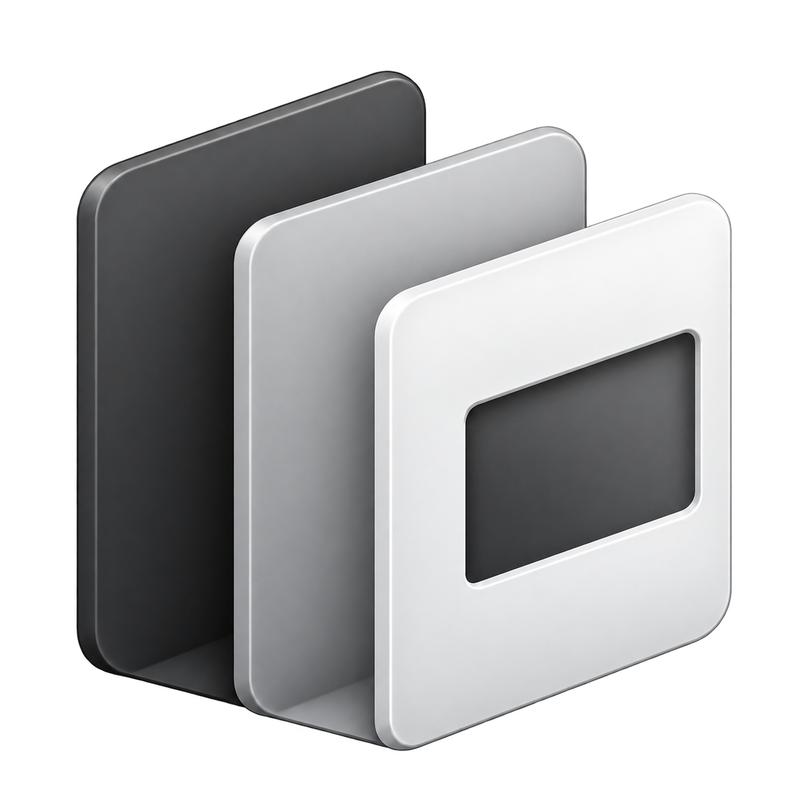

# Lit Explorer

A Windows x64 and macOS 12+ project browser with column navigation, file previews, pinned panes and split reading.

## Install

Download from [Releases](https://github.com/wwjei/lit-explorer/releases):

- `Lit-Explorer-Setup-<version>.exe`: installer.
- `Lit-Explorer-<version>-portable.exe`: portable application.
- `Lit-Explorer-<version>-macOS-universal.dmg`: Apple Silicon + Intel; drag the app into Applications.
- `SHA256SUMS.txt`: checksums for all three files.

There is one product: **Lit Explorer**. The default installation folder is
`%LOCALAPPDATA%\Programs\Lit Explorer`; settings are stored in `%APPDATA%\Lit Explorer`.
Upgrades migrate compatible settings and protected credentials from earlier versions without overwriting current settings.
The application requires WebView2 Runtime, included with Windows 11 and usually present through Edge on Windows 10.

Browse local projects and read-only reference folders; preview Markdown, source, images, SVG, HTML, PDF, Word and PowerPoint.
Pin and split previews, use Ctrl+F, zoom images, edit simple SVGs, or add web and cloud directory shortcuts.
Cloud directory pages are cached for 48 hours during a connection. Right-click a folder to refresh only that folder.

Builds are not code-signed. Verify downloaded executables against `SHA256SUMS.txt`.
See [README.md](README.md) for full usage, development and release instructions.

On macOS the app uses WKWebView, native window controls and Command shortcuts. Local files preview in the app; web links and cloud documents open in the default browser. Cloud folders remain browsable in the app. Settings live in `~/Library/Application Support/Lit Explorer`; cloud credentials use Keychain protection. The DMG is ad hoc signed and not notarized. If blocked, confirm the download source and use System Settings → Privacy & Security → Open Anyway.
