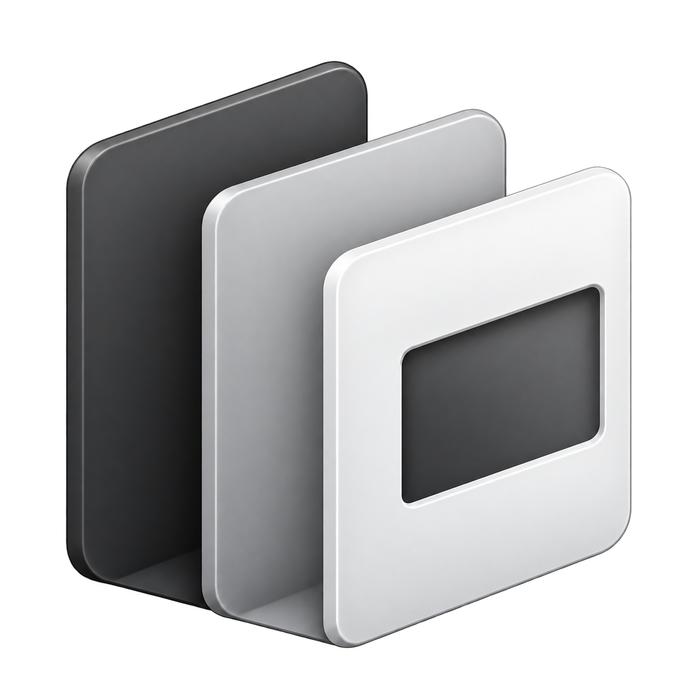

# Lit Explorer



面向开发者的本地项目文件浏览器：多栏目录导航、即时文件预览、固定与分屏阅读。
支持 Windows x64 与 macOS 13+（Apple Silicon / Intel）。

## 下载与安装

从 [Releases](https://github.com/wwjei/lit-explorer/releases) 下载：

- `Lit-Explorer-Setup-<version>.exe`：安装版，可选择目录。
- `Lit-Explorer-<version>-portable.exe`：免安装版。
- `Lit-Explorer-<version>-macOS-universal.dmg`：macOS 通用包，打开后拖入 Applications。
- `SHA256SUMS.txt`：以上三个文件的 SHA-256 校验和。

产品名称统一为 **Lit Explorer**，仅提供一个版本。默认安装目录为
`%LOCALAPPDATA%\Programs\Lit Explorer`，设置与本机授权位于 `%APPDATA%\Lit Explorer`。
安装器会接管旧安装登记、清理旧快捷方式，并注册“用 Lit Explorer 打开”文件夹菜单。
首次启动自动迁移旧版本的项目设置和可兼容的本机授权；已有新设置不覆盖，旧数据保留。
卸载不会删除用户设置。

运行需要 WebView2 Runtime（Windows 11 自带，Windows 10 通常随 Edge 提供）。
尚未配置代码签名，Windows SmartScreen 可能提示“未知发布者”。可在下载目录核对：

```bash
sha256sum -c SHA256SUMS.txt
```

### macOS

使用系统 WKWebView，无需另装 WebView2。设置位于 `~/Library/Application Support/Lit Explorer`。
保留系统红黄绿窗口按钮，快捷键使用 `Command`（如 `⌘O`、`⌘F`）。
本地文件在应用内预览；网页链接及云文档内容通过默认浏览器打开，云目录列表仍在应用内浏览。
金山授权用登录钥匙串保护随机密钥，本地只保存加密授权；系统保护不可用时仅保留本次会话。

当前 DMG 采用临时签名，尚未做 Developer ID 签名与 Apple 公证。
若首次打开被拦截，确认下载来源后可在“系统设置 → 隐私与安全性 → 仍要打开”允许。

## 使用

首次启动可以打开项目文件夹，或选择“打开示例项目”。

- 左侧多栏浏览目录，单击文件在右侧预览；双击交给系统默认程序。
- 支持 Markdown、源码、图片、SVG、HTML、PDF、Word 与 PowerPoint 预览。
- 图钉固定预览，最多三列；拖动窗格抓手调整位置，拖到固定列下方可上下分屏。
- 预览/源码切换、`Ctrl+F` 查找、图片缩放和连续预览。
- SVG 轻量编辑：移动、矩形缩放、改字、删除、撤销重做和自动保存；磁盘冲突时停写。
- 顶部刷新按钮只重新读取有变化的本地内容，并刷新打开的云目录面板。
- 快捷访问可添加本地文件、文件夹、网页、外部只读参考目录及云目录。
- 每个项目记住导航位置、固定布局、列宽和分屏比例。

详细行为与限制见 [FEATURES.md](FEATURES.md)。许可说明可从应用菜单打开。

### 外部目录与云文档

“添加外部目录”通过系统选择框授权，每项目最多 32 个；支持浏览与预览，不允许写入。
移除参考目录会撤销其访问权限并清理相应预览。

云目录支持飞书文件夹、Wiki 节点目录及金山个人云文档文件夹。单篇文档直接作为网页链接添加。
金山通过官方浏览器页面授权，无需安装额外工具或复制令牌；可留空目录标识浏览“我的文档”，
也可指定文件夹，并把子目录加入快捷访问。飞书的客户端授权为实验功能，组织可能限制应用创建与权限。
真实平台资格、共享范围与链接可用性取决于账号授权。

金山凭据由系统保护保存；不支持保护时仅保留在当前运行，授权过期后重新确认。
云目录列表在当前连接内缓存 **48 小时**，每连接最多 128 页，不跨重启保存。
右键文件夹或快捷访问中的云目录选择“刷新此文件夹”，清除该目录全部分页后重读直接内容，
其他目录继续使用缓存。目录面板刷新与应用级刷新使用相同规则。

### 常用操作

| 操作 | 快捷键 |
| --- | --- |
| 选择文件 | ↑ / ↓ |
| 进入目录 / 返回上级 | → / ← |
| 用默认程序打开 | Enter |
| 当前预览查找 | Ctrl+F |
| 显示 / 隐藏临时预览 | Ctrl+B |
| 刷新变化内容 | F5 |
| 切换主题 | Ctrl+Shift+L |

## 隐私与边界

本地读取限定在当前项目和用户授权的参考目录中，真实路径检查防止链接越界。
普通文件默认只读；SVG 保存还校验扩展名、大小、编码和磁盘版本。
内嵌网页与远程图片会联网，站点可维护自己的登录信息；远程页面没有本地文件桥接权限。
应用不提供任意云端写入或第三方可执行插件安装。

## 开发

产品采用 Go + 系统 WebView2，技术宿主位于 `mygo/`，渲染层位于 `src/renderer/`。
框架名仅用于技术文档与第三方许可，不作为产品名称。
需要 Node.js、Go 1.27+；发布安装包还需要 NSIS。开发工具和测试不进入产品。

```bash
npm ci
npm run build
npm start                 # Windows 启动原生产品
npm test                  # 渲染器单元及界面契约测试
node mygo/stage-frontend.mjs
cd mygo && go test ./...
```

Electron 仅用作跨平台界面测试工具，测试宿主在 `test/host/`；没有 Electron 产品入口或安装包。
原生窗口、文件授权、系统保护与网页视图的产品实现只维护 Go 代码。
结构入口见 [CODEMAP.md](CODEMAP.md)，开发约束见 [AGENTS.md](AGENTS.md)。

## 发布

```bash
npm run dist              # 生成唯一产品的安装包与便携包
node scripts/build-checksums.mjs
```

发布通过带版本号的 `v*` 标签触发 CI：先测试，再构建、执行安装/升级/卸载验证、生成校验和并发布。
带 `-alpha` / `-beta` 的标签为预发布。流程见 [发版说明](docs/agents/release.md)。
