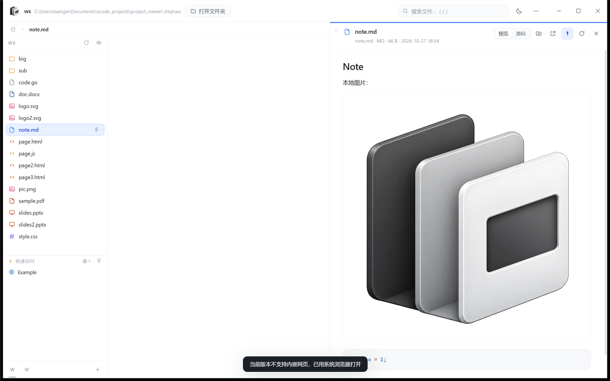

# MyGo 移植实验：体积、能力与代价

2026-10 · 分支 `spike/mygo`

## 1. 问题

Windows 安装包 122.4 MB（免安装版 111.3 MB），其中 `electron.exe` 一项就占压缩后
约 104 MB。想验证：换成一个不打包 Chromium 的框架，体积能降到多少、哪些功能会丢。

选 [MyGo](https://github.com/egoist/mygo) v0.7.1：Go 写后端、Windows 上用系统
WebView2，产物是单个 Go 可执行文件。它提供 `Bind`（JS ↔ Go 的 JSON RPC）、
自定义协议、原生菜单 / 对话框 / 剪贴板、无边框窗口、单实例锁——正好覆盖这个应用的
主进程能力。

## 2. 做法

**渲染层零改动复用。** 现有 `src/renderer` 只依赖 `window.pv`（Electron preload 暴露
的 39 个方法 / 事件）。MyGo 的 `Page.PreloadScript` 在页面脚本之前注入
`mygo/bridge.js`，用 `window.mygo.call("App.X")` 实现同形的 `window.pv`，其余界面代码
原样运行。主进程能力用 Go 重写：

| Electron | MyGo 版 |
| --- | --- |
| `fs-api.js` | `mygo/fsapi.go`（真实路径校验、junction 边界、读上限、SVG 保存基线） |
| `store.js` + `state-sanitize.js` | `mygo/statefile.go`（白名单字段、offered root 校验） |
| `pv://` 协议 | 本机回环预览服务（见 §5） |
| `Menu` / `dialog` / `clipboard` | MyGo `Menu` / `Dialog` / `Clipboard` |
| `WebContentsView` | **没有对应物，能力屏蔽** |

## 3. 结果

### 体积

| | Electron 版 | MyGo 版 |
| --- | --- | --- |
| 用户下载 | 122.4 MB（NSIS）/ 111.3 MB（portable） | **18.6 MB** 单文件 exe |
| 安装后 | 约 369 MB（Electron 分发目录）+ 应用 | 18.6 MB（不含系统 WebView2） |
| 其中前端资源 | `app.asar` 约 5 MB | 内嵌 5.9 MB / 116 个文件 |
| 缩减 | — | **−84.8%**（对比 NSIS 安装包） |

18.6 MB 里 Go 运行时与本应用代码约 12.7 MB，其余是内嵌的渲染层（shiki 语法包
4.4 MB 占大头）。前端不再单独分发，也没有额外运行时文件。

### 启动与内存（同一台机器，隔离数据目录，开着一个 16 文件 + 一张 1.1 MB 图片的工作区）

| | Electron 版 | MyGo 版 |
| --- | --- | --- |
| 启动到窗口可交互 | 1.66 s | 2.17 s |
| 工作集（整棵进程树） | 473 MB | 602 MB |
| 私有内存 | 392 MB | 400 MB |
| 进程数 | 4 | 8（Go + WebView2 的 6 个辅助进程） |

体积收益明确；**内存没有变好**——Chromium 只是从随包分发变成了系统 WebView2，
工作集反而更高（WebView2 起了更多辅助进程），私有内存基本持平。启动也慢约 0.5 s
（首次创建 WebView2 环境）。

### 功能验证

| 能力 | 结果 |
| --- | --- |
| 多栏导航、面包屑、目录切换 | ✅ 与 Electron 版一致 |
| 大目录虚拟滚动 | ✅ 400 项目录只渲染 62 行 |
| 文件元信息异步补发（`fs:meta`） | ✅ 预览头显示大小 / 修改时间 |
| 代码高亮、Markdown、本地图片 | ✅ 见[截图](#截图) |
| 图片 / SVG 预览 | ✅ PNG 1.1 MB、SVG 均正常解码 |
| HTML 预览（相对 CSS / JS / 脚本） | ✅ 页面里的 CSS 与 `page.js` 都生效，`postMessage` 回报 `JS_OK` |
| PDF 预览 | ✅ Edge 内置阅读器渲染出正文与工具栏 |
| Word (.docx) 预览 | ✅ docx-preview 渲染出正文 |
| PPT (.pptx) 预览 | ✅ pptx-preview 渲染出表格、图片、连接线（`minimal.pptx` 结构过简，库本身报错，换正常文件通过） |
| 固定列 / 多列并排 | ✅ 固定 Markdown 后临时列继续预览 PPT，两列内容独立 |
| 预览内查找 | ✅ `Ctrl+F`、命中高亮、`1/1` 计数、`Esc` 关闭 |
| 主题切换与持久化 | ✅ `state.json` 立即写入 |
| 项目快捷切换 | ✅ 两个项目切换后根目录、列表、列数重置正确 |
| 窗口最大化 / 还原、尺寸持久化 | ✅ 状态回写 |
| SVG 保存（含冲突检测） | ✅ 写入成功、旧基线返回 `CONFLICT`、工作区外返回 `EACCES_ROOT` |
| 单实例锁 | ✅ 第二个实例 490 ms 内退出，第一个保留 |
| 剪贴板写入 | ✅ 从 Windows 剪贴板读回 |
| 右键菜单 / ⋯ 应用菜单 | ⚠️ 已用 MyGo `Menu` 实现并调用不崩；本机窗口不在可见桌面，`SendKeys` 无法聚焦，弹层未能自动确认 |
| 文件夹 / 图标选择对话框 | ⚠️ 已用 `Dialog.Open` 实现，需人工点一次 |
| 拖放文件夹打开工作区 | ⚠️ 已接 `OnFileDrop`，未自动验证 |
| **内嵌网页（网页快速访问）** | ❌ **屏蔽**：点击改为系统浏览器打开 + 提示；web 固定列加载时丢弃 |

## 4. 损失与风险

1. **内嵌网页没有替代物。** Electron 的 `WebContentsView` 让每个网页列拥有独立视图、
   持久登录态、剪贴板授权询问；WebView2 只有窗口级 webview，没有等价的子视图。
   这是产品功能表里明确列着的「网页快速访问」，移植后会退化为「快速链接」。
   同一原因，网页列头部按钮（重新加载 / 固定网页）与失败卡片也失去意义。
2. **预览服务换了实现。** WebView2 的自定义 scheme 只把主框架的请求交给 Go：
   HTML 预览 iframe 里的相对 `css/js` 根本到不了处理器（已实测：主页面 `fetch` 能到，
   iframe 内 `fetch` / `` 都失败）。原型改用绑定 `127.0.0.1` 的随机端口 +
   随机令牌预览服务，每个请求仍走工作区白名单。可行，但比 `pv://` 多了一个本机
   监听面，需要额外的安全评审。
3. **WebView2 从「随包」变成「依赖系统」。** Windows 11 自带；Windows 10 需要
   Evergreen Runtime。换来的是渲染内核跟随 Edge 升级——docx/pptx/PDF 的渲染一致性
   要重新建立回归基线。
4. **框架成熟度。** MyGo v0.7.1 发布于实验当天，API 仍在快速演进（本实验就踩到
   自定义 scheme 只覆盖主框架的问题）。把发布路径压在一个这样年轻的框架上，
   要接受后续升级成本。
5. **发布链未完成。** 本次只产出单文件 exe，没有做 NSIS 安装包、图标嵌入、签名与
   自动更新；`mygo build` 声称能出 Windows 安装包，未实测。
6. **构建链更重。** 需要 Go 1.27+ 工具链；前端要先 `npm run build` 再 stage 进
   `mygo/frontend/`（生成物、不入库）。CI 要同时维护 Node 与 Go 两套环境。

## 5. 截图

说明：截图由 `PrintWindow`（`PW_RENDERFULLCONTENT`）直接取窗口内容，DPI 缩放已校正，
所以分辨率是 2520×1575。

Markdown + 本地图片 + 代码高亮：

HTML 预览（相对 CSS 与脚本都生效）：

Word 预览：

PPT 预览：

PDF 预览（Edge 内置阅读器）：

固定列 + 临时列并排：

预览内查找：

网页快捷访问的降级（系统浏览器 + 提示）：

## 6. 能不能 fork MyGo 把内嵌网页补回来

先给结论：**技术上可行，但这是一项框架特性，不是配置或小补丁。**

MyGo 已经有「窗口里嵌 webview」的原语：`Window.NewWebView()` +
`ui.WebView`，但只允许 native UI 窗口（`WindowOptions.Content`），页窗口调用会返回
`errNoContent`。它内部的实现是 `ICoreWebView2CompositionController` +
DirectComposition（`internal/windows/webview_embed.go`、`surface.go`）：视觉树、裁剪、
输入转发都已经在跑。而我们的页窗口用的是经典 `ICoreWebView2Controller`
（`ctlPutIsVisible`），微软对「同一窗口里叠两个经典 WebView2 控制器」是不支持的。

所以要补的不是「渲染第二个页面」，而是把页窗口也放进 composition 那套：

1. 页窗口的主 webview 换成 CompositionController（或给页窗口加一层 composition
   覆盖层），复用现有 visual 树；
2. 放开 `NewWebView` 的 `content == nil` 限制，提供「按矩形放置」的 API，不依赖
   native UI 布局；
3. 输入路由 / 命中测试 / 焦点：native UI 有一套现成的，页窗口要按窗格矩形拦截并
   转给子控制器；
4. 每个网页视图独立 profile（WebView2 `ProfileName`），保住「登录态互不串」；
   MyGo 现在是应用级 profile；
5. 导航 / 加载 / 权限 / 剪贴板询问 → 页事件，形状可以沿用现在的 `web:state`。

成本：Windows 上是 COM + DirectComposition 的活，熟悉这套代码的人大约 1–2 周出原型，
再加 macOS（WKWebView 的 subview，容易）与 Linux（WebKitGTK）与回归。MyGo 还在
0.7.x，API 和内部结构都在动，fork 需要持续跟上游。

**不 fork 的替代**：用 MyGo 现有的 `WindowOptions.Parent` + `Panel` 开一个无边框子
窗口，盖在网页窗格的位置上，由布局事件驱动移动。能实现，但会露出独立窗口的痕迹
（阴影、圆角裁剪、焦点、Alt-Tab、跨显示器移动），和 Electron 的 `WebContentsView`
差距明显，只适合当临时方案。

建议：先向上游提 issue / PR（这个能力对 MyGo 有普遍价值，底层设施已经有了）；
只有在「必须自带内嵌网页列且接受长期维护 fork」时才自己改。

## 7. 结论

- **体积**：18.6 MB vs 122.4 MB，缩减 84.8%，是这次实验唯一确定的大收益。
- **功能**：除内嵌网页外，界面与预览能力基本无损；内嵌网页需要重新设计（外部窗口
  或放弃），不是配置能补的。
- **代价**：内存没有变好、启动略慢、依赖系统 WebView2、框架很年轻、预览服务需要
  安全复核、发布链要重做。

建议：**除非「安装包 < 20 MB」是硬指标，否则不值得为此重写主进程。** 若确实是硬指标，
MyGo 路线可承载约 95% 的界面能力，但「网页快速访问」必须按降级方案改产品定义，
并且要先补齐原生菜单 / 对话框 / 拖放的人工验收与安装包链路。
