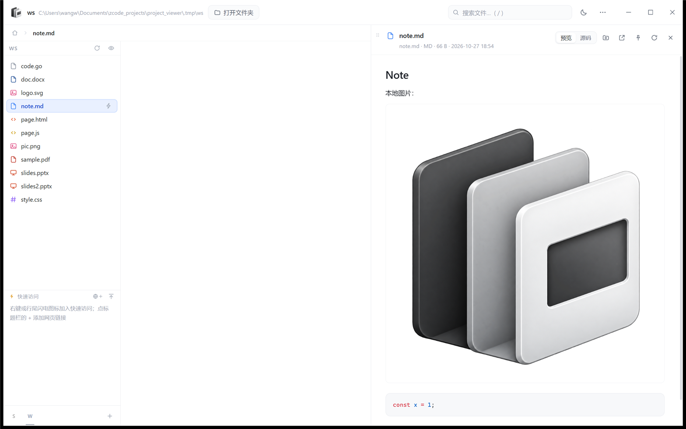
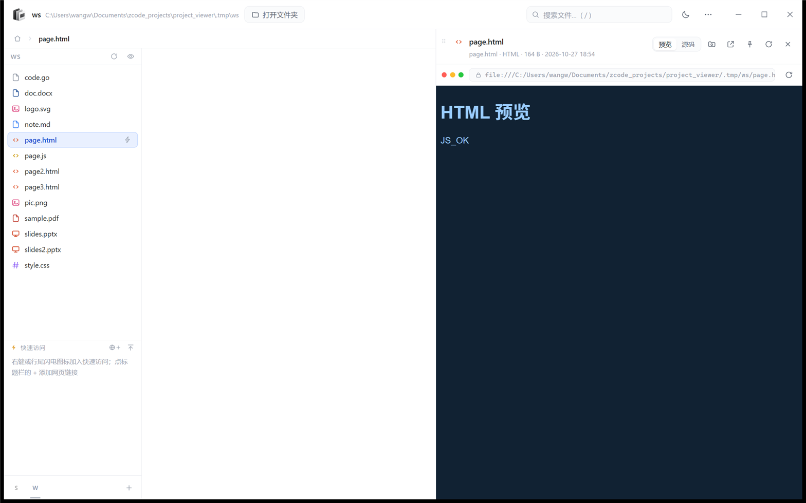
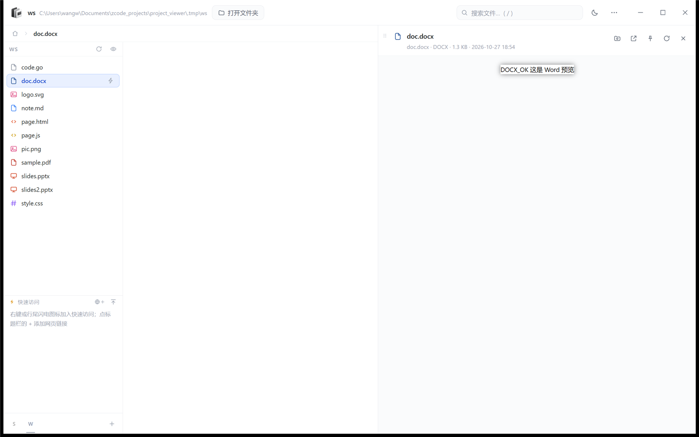
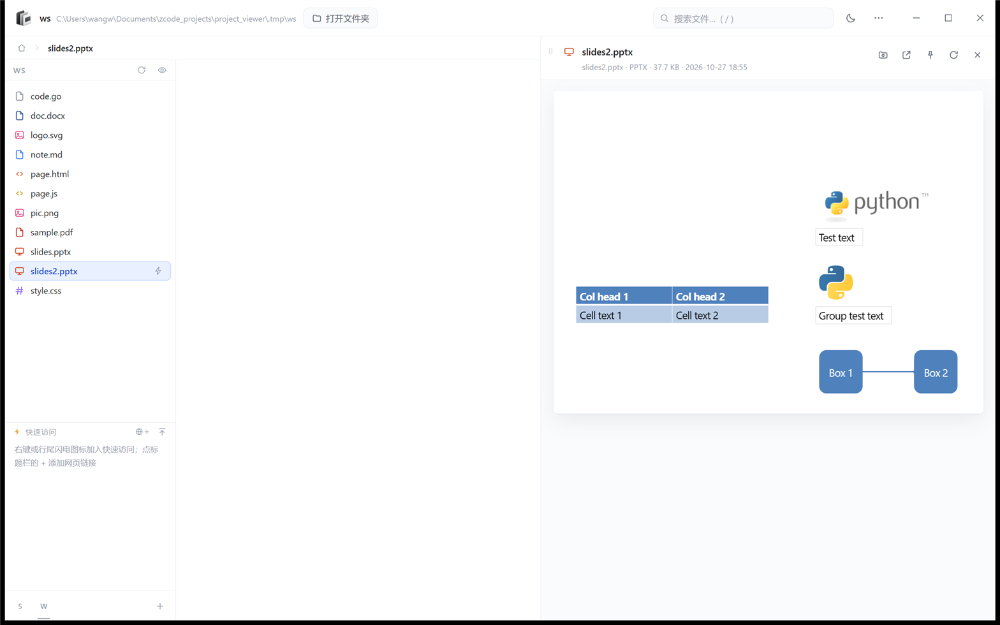
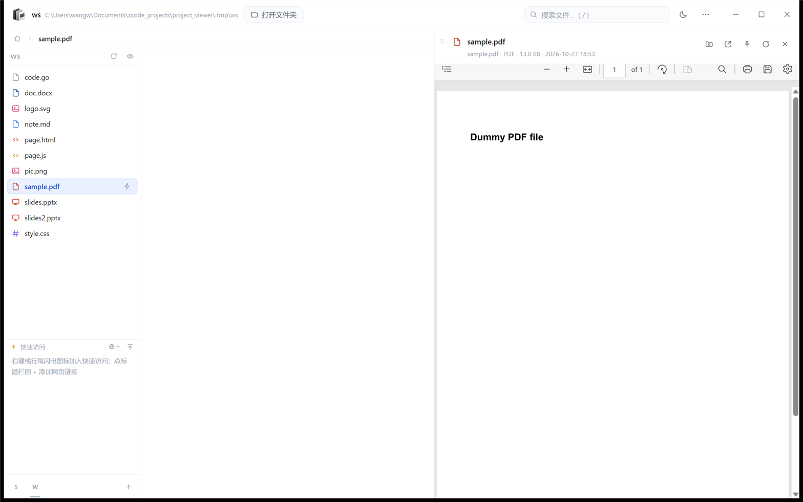
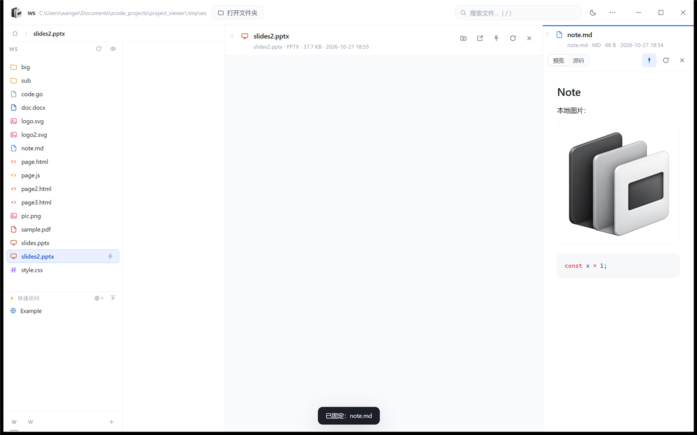
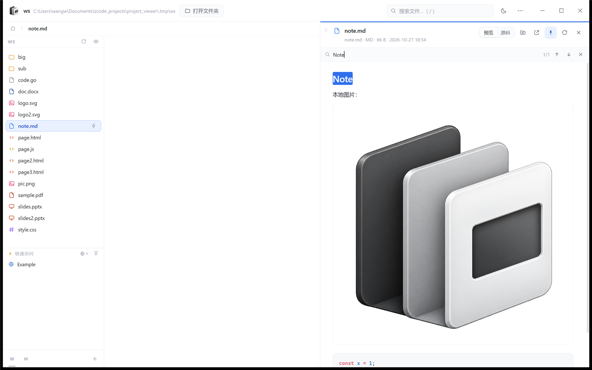
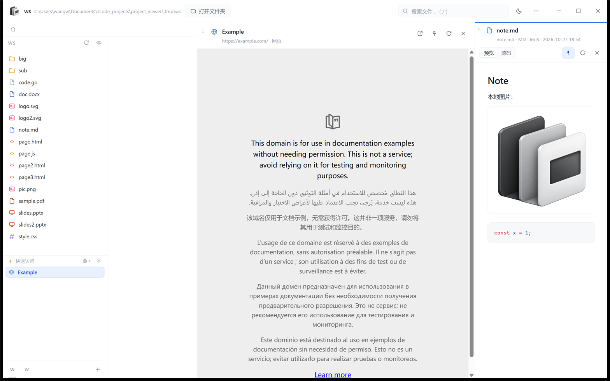
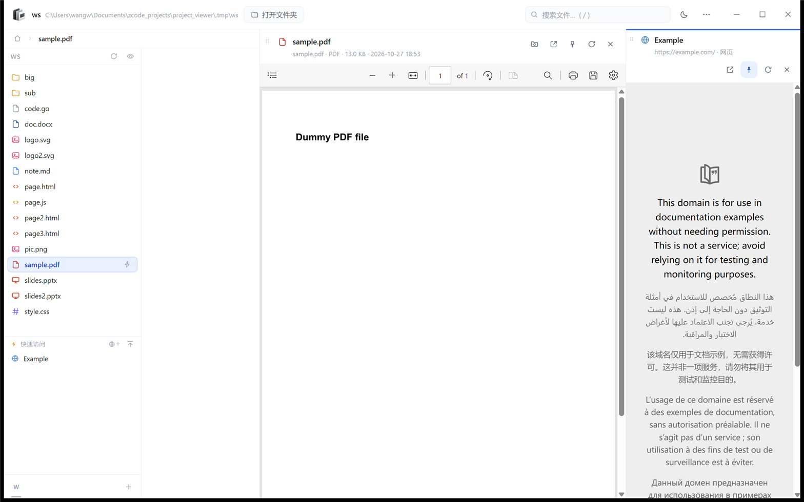

# MyGo 移植：体积、能力与代价

2026-10 · 实验分支 `spike/mygo`，已合入 main 并成为随 Release 发布的第二个 Windows 构建

## 1. 问题

Windows 安装包 122.4 MB（免安装版 111.3 MB），其中 `electron.exe` 一项就占压缩后
约 104 MB。想验证：换成一个不打包 Chromium 的框架，体积能降到多少、哪些功能会丢。

选 [MyGo](https://github.com/egoist/mygo) v0.7.1：Go 写后端、Windows 上用系统
WebView2，产物是单个 Go 可执行文件。它提供 `Bind`（JS ↔ Go 的 JSON RPC）、
自定义协议、原生菜单 / 对话框 / 剪贴板、无边框窗口、单实例锁——正好覆盖这个应用的
主进程能力。

## 2. 做法

**渲染层零改动复用。** 现有 `src/renderer` 只依赖 `window.pv`（Electron preload 暴露
的 39 个方法 / 事件）。MyGo 的 `Page.PreloadScript` 在页面脚本之前注入
`mygo/bridge.js`，用 `window.mygo.call("App.X")` 实现同形的 `window.pv`，其余界面代码
原样运行。主进程能力用 Go 重写：

| Electron | MyGo 版 |
| --- | --- |
| `fs-api.js` | `mygo/fsapi.go`（真实路径校验、junction 边界、读上限、SVG 保存基线） |
| `store.js` + `state-sanitize.js` | `mygo/statefile.go`（白名单字段、offered root 校验） |
| `pv://` 协议 | 本机回环预览服务（见 §4） |
| `Menu` / `dialog` / `clipboard` | MyGo `Menu` / `Dialog` / `Clipboard` |
| `WebContentsView` | fork 里的 `Window.NewChildWebView()`（见 §6） |

## 3. 结果

### 体积

| | Electron 版 | MyGo 版 |
| --- | --- | --- |
| 用户下载 | 122.4 MB（NSIS）/ 111.3 MB（portable） | **5.5 MB**（NSIS）/ **17.8 MB**（portable） |
| 安装后 | 约 369 MB（Electron 分发目录）+ 应用 | 17.8 MB（不含系统 WebView2） |
| 其中前端资源 | `app.asar` 约 5 MB | 内嵌 5.8 MB / 96 个文件 |
| 缩减 | — | **−95.5%**（对比 NSIS 安装包）/ −84.0%（对比 portable） |

17.8 MB 的免安装 exe 里 Go 运行时与本应用代码约 12.7 MB，其余是内嵌的渲染层
（shiki 语法包 4.4 MB 占大头）。前端不再单独分发，也没有额外运行时文件。

### 启动与内存（同一台机器，隔离数据目录，开着一个 16 文件 + 一张 1.1 MB 图片的工作区）

| | Electron 版 | MyGo 版 |
| --- | --- | --- |
| 启动到窗口可交互 | 1.66 s | 2.17 s |
| 工作集（整棵进程树） | 473 MB | 602 MB |
| 私有内存 | 392 MB | 400 MB |
| 进程数 | 4 | 8（Go + WebView2 的 6 个辅助进程） |

体积收益明确；**内存没有变好**——Chromium 只是从随包分发变成了系统 WebView2，
工作集反而更高（WebView2 起了更多辅助进程），私有内存基本持平。启动也慢约 0.5 s
（首次创建 WebView2 环境）。

### 功能验证

| 能力 | 结果 |
| --- | --- |
| 多栏导航、面包屑、目录切换 | ✅ 与 Electron 版一致 |
| 大目录虚拟滚动 | ✅ 400 项目录只渲染 62 行 |
| 文件元信息异步补发（`fs:meta`） | ✅ 预览头显示大小 / 修改时间 |
| 代码高亮、Markdown、本地图片 | ✅ 见[截图](#截图) |
| 图片 / SVG 预览 | ✅ PNG 1.1 MB、SVG 均正常解码 |
| HTML 预览（相对 CSS / JS / 脚本） | ✅ 页面里的 CSS 与 `page.js` 都生效，`postMessage` 回报 `JS_OK` |
| PDF 预览 | ✅ Edge 内置阅读器渲染出正文与工具栏 |
| Word (.docx) 预览 | ✅ docx-preview 渲染出正文 |
| PPT (.pptx) 预览 | ✅ pptx-preview 渲染出表格、图片、连接线（`minimal.pptx` 结构过简，库本身报错，换正常文件通过） |
| 固定列 / 多列并排 | ✅ 固定 Markdown 后临时列继续预览 PPT，两列内容独立 |
| 预览内查找 | ✅ `Ctrl+F`、命中高亮、`1/1` 计数、`Esc` 关闭 |
| 主题切换与持久化 | ✅ `state.json` 立即写入 |
| 项目快捷切换 | ✅ 两个项目切换后根目录、列表、列数重置正确 |
| 窗口最大化 / 还原、尺寸持久化 | ✅ 状态回写 |
| SVG 保存（含冲突检测） | ✅ 写入成功、旧基线返回 `CONFLICT`、工作区外返回 `EACCES_ROOT` |
| 单实例锁 | ✅ 第二个实例 490 ms 内退出，第一个保留 |
| 剪贴板写入 | ✅ 从 Windows 剪贴板读回 |
| 右键菜单 / ⋯ 应用菜单 | ⚠️ 已用 MyGo `Menu` 实现并调用不崩；本机窗口不在可见桌面，`SendKeys` 无法聚焦，弹层未能自动确认 |
| 文件夹 / 图标选择对话框 | ⚠️ 已用 `Dialog.Open` 实现，需人工点一次 |
| 拖放文件夹打开工作区 | ⚠️ 已接 `OnFileDrop`，未自动验证 |
| **内嵌网页（网页快速访问）** | ✅ 靠 fork 的 `ChildWebView` 实现：页面盖在窗格矩形上，`web:state` 的 loading / loaded / navigated / error / gone 与 Electron 同形；`target=_blank` 交给系统浏览器；web 固定列可保存并恢复 |

## 4. 损失与风险

1. **内嵌网页要维护一个 fork。** 原版 MyGo 的 `NewWebView` 只允许 native UI 窗口；
   fork 补了 `ChildWebView`（子 HWND + 独立的 WebView2 经典控制器）。微软并不官方
   支持同一窗口叠加两个 WebView2 控制器，实测可用，但这是长期维护点：MyGo 升级要
   rebase fork，WebView2 升级、窗口在不同 DPI 显示器间移动都要复测。
2. **网页能力有几处弱化。** 子 webview 与主页面共用应用级 profile（登录态持久，
   但没有 Electron 那样的独立分区）；站点权限（剪贴板读取等）没有按站询问，
   走 WebView2 默认策略；`target=_blank` 交给系统浏览器（与 Electron 一致）。
3. **预览服务换了实现。** WebView2 的自定义 scheme 只把主框架的请求交给 Go：
   HTML 预览 iframe 里的相对 `css/js` 根本到不了处理器（已实测：主页面 `fetch` 能到，
   iframe 内 `fetch` / `` 都失败）。实现改为绑定 `127.0.0.1` 的随机端口 +
   随机令牌预览服务，每个请求仍走工作区白名单。可行，但比 `pv://` 多了一个本机
   监听面，需要额外的安全评审。
4. **WebView2 从「随包」变成「依赖系统」。** Windows 11 自带；Windows 10 需要
   Evergreen Runtime。换来的是渲染内核跟随 Edge 升级——docx/pptx/PDF 的渲染一致性
   要重新建立回归基线。
5. **框架成熟度。** MyGo v0.7.1 发布于实验当天，API 仍在快速演进（本实验就踩到
   自定义 scheme 只覆盖主框架的问题）。要接受后续升级与 rebase fork 的成本。
6. **发布链已补齐。** NSIS 安装包、图标与版本元数据都已跑通（`npm run dist:mygo`
   产出 5.5 MB 安装包 / 17.8 MB 免安装版）；代码签名与自动更新与 Electron 版一样
   还没做，原因见 [further_notes.md](../../further_notes.md) 的 N4 / N5。
7. **构建链更重。** 需要 Go 1.27+ 工具链；前端要先 `npm run build` 再 stage 进
   `mygo/frontend/`（生成物、不入库）。CI 要同时维护 Node 与 Go 两套环境。

## 5. 截图

说明：截图由 `PrintWindow`（`PW_RENDERFULLCONTENT`）直接取窗口内容，DPI 缩放已校正，
所以分辨率是 2520×1575。

Markdown + 本地图片 + 代码高亮：

HTML 预览（相对 CSS 与脚本都生效）：

Word 预览：

PPT 预览：

PDF 预览（Edge 内置阅读器）：

固定列 + 临时列并排：

预览内查找：

网页窗格（临时列里打开 https://example.com）：

固定住的网页列 + 临时列预览 PDF：

## 6. fork 里补了什么

内嵌网页最终是用 fork 实现的：[wwjei/mygo](https://github.com/wwjei/mygo)
`v0.7.1-lit.2`（基于 v0.7.1），新增 `Window.NewChildWebView()`。

**为什么必须改框架**：原版 MyGo 只有两种 webview 用法——页窗口一个铺满的经典
`ICoreWebView2Controller`，或 native UI 窗口里的 WebView2 **CompositionController**
（`Window.NewWebView`，但页窗口调用返回 `errNoContent`）。微软不官方支持同窗口叠加
两个经典控制器，所以不能只在应用层加一个视图。

**fork 的做法**（`internal/windows/childwebview.go`）：给每个网页窗格建一个
`WS_CHILD` 子窗口（`STATIC` 类），把独立的经典 WebView2 控制器挂在这个子 HWND 上，
用 `SetWindowPos(HWND_TOP)` 压在页面的 webview 之上；DIP 矩形按窗口 DPI 换算成物理
像素；隐藏时同时 `ShowWindow` 与 `controller.put_IsVisible`。事件只接需要的
NavigationStarting / NavigationCompleted / ProcessFailed / NewWindowRequested，
转成 `loading / loaded / error / gone / popup` 状态。

**应用层**：`App.WebSync` 按地址保活视图（同一地址只留一份，地址移出列表就销毁），
`WebReload` 刷新，状态转成 Electron 的 `web:state` 载荷；`target=_blank` 与 Electron
一样交给系统浏览器；web 固定列恢复保存 / 恢复。

**代价与边界**：

- 子 webview 与主页面共用应用级 profile，没有独立分区；站点权限（剪贴板读取等）
  走 WebView2 默认策略，没有 Electron 的按站询问。
- 微软不官方支持同窗口叠加经典控制器，实测可用，但这是 fork 最脆的一处：
  WebView2 升级、跨 DPI 显示器移动、窗口层级变化都要复测。
- 只有 Windows 后端实现了 `ChildWebView`；macOS / Linux 调用会返回
  “not supported on this platform”。
- fork 需要跟随上游 rebase（本项目用 `replace` 指向 fork tag，改版本号即可）。

更省事的顺序仍然是先向上游提 issue / PR：这个能力对 MyGo 有普遍价值，fork 里只有
Windows 一份实现，补上 macOS（WKWebView subview）与 Linux（WebKitGTK）更适合放在上游。

## 7. 结论

- **体积**：18.6 MB vs 122.4 MB，缩减 84.8%，是这次实验唯一确定的大收益。
- **功能**：界面与预览能力全部跑通；内嵌网页靠 fork 补回，与 Electron 版行为基本一致
  （差异是 profile 共享与站点权限默认策略）。
- **代价**：内存没有变好、启动略慢、依赖系统 WebView2、框架很年轻、需要维护一个
  Windows 端的 fork、预览服务需要安全复核、发布链要重做。

建议：**除非「安装包 < 20 MB」是硬指标，否则不值得为此重写主进程并维护 fork。**
若确实是硬指标，MyGo 路线现在能覆盖全部界面能力，但要接受 fork 的长期维护成本，
并先补齐原生菜单 / 对话框 / 拖放的人工验收与安装包链路。
