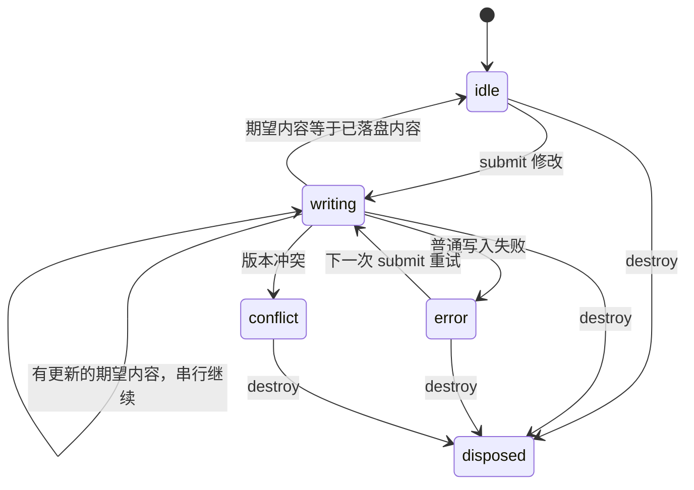

# 界面生命周期与异步转换

共享 renderer 同时用于 Electron 与 MyGo。这里记录跨回调的状态与资源归属，避免用单个“加载中”标志代替多个独立生命周期。

## 窗格与渲染任务

`pane.js` 的窗格状态为 `alive → destroyed`，销毁不可逆。先标记终态、递增 `reqId`，再卸载 view、查找条和 DOM。

- `bodyKey`：显示内容的身份，相同身份可复用正文。
- `reqId`：渲染任务的身份，强制重读也创建新身份。
- `pending`：尚未结算的全部任务数，包含已经失效但尚未返回的任务。
- `task.stale`：窗格已销毁，或 reqId 不再匹配。正文写入及后续资源创建必须检查它。

清空工作区、收起已迁移的临时正文与销毁窗格，都使旧任务失去写入资格。隐藏保活的正文不等于销毁。

## 工作区与导航事务

`app.js` 显式维护：

| 状态/身份 | 意义 |
| --- | --- |
| `workspacePhase` | `idle → loading → ready`；恢复未完成时不把中间快照存成项目布局 |
| `workspaceEpoch` | 每次 opened 事件递增，A→B→A 中两次 A 是不同工作区实例 |
| `navigationEpoch` | 每次用户导航意图递增，中断旧的快捷定位、Markdown 链接定位和保存导航恢复 |
| navigation ticket | 捕获工作区与导航双重身份，跨 await 后校验才能继续修改界面 |
| `columnRequest` | 全页面单调递增的列表请求编号，不随列销毁或项目切换复用 |

初始化只读取一次设置；openRoot 等待 settingsReady 后执行一次导航恢复。用户导航能中断恢复，其最新选择优先，旧恢复不能再套用源码模式或固定布局。

单列 `init → loading → ready/error`，响应还要匹配原来的 slot 对象。`pv.list(dir, requestId=0)` 的异步元信息回传 `{dir, metas, requestId}`，仅当前列接受；Electron preload/IPC 和 MyGo bridge/宿主契约相同。requestId 只是相关性编号，不授予路径权限。

`changes.js` 的晚到 stat 也检查工作区、窗格任务及目录加载身份；刷新事务不能跨项目或新导航继续恢复滚动、显示完成提示。

## SVG 保存

`save-queue.js` 提供 `PV.saveQueue.create()`，由 SVG 编辑器拥有并在 destroy 时 dispose。

- 分别记录期望内容/版本、正在写入版本、已落盘内容/版本。
- 一次最多一个写入，积压的中间修改合并为最新期望内容。
- 正在写 B 时撤销回已保存过的 A，也必须在 B 完成后再写 A。不能在入队前以旧的 persisted 快照跳过。
- 每次成功先更新文件基线，下一次写使用新 size/mtime；只有期望版本实际落盘才显示“已保存”。
- 冲突停写，须刷新重建编辑器；普通失败不无限重试，后续提交可重试。
- disposed 后不再发送积压修改或处理结果。已发出的文件写入无法撤销；窗口关闭/退出编辑不提供“等待所有修改落盘”的承诺。

## 弹层、网页遮挡与原生图片选择

`PV.web.acquireOcclusion()` 和 `acquireDragHide()` 返回独立、幂等的释放函数。owner 集合非空就保持隐藏；某个 owner 释放不会解除另一个 owner 的遮挡。

网页表单、项目图标 picker、云目录 dialog、每次拖动分别持有自己的释放句柄。打开/关闭、取消、失焦、丢失指针捕获和工作区清理必须成对释放。

图标图片选择捕获 picker session 与项目对象。原生对话框返回时，两者仍有效才能应用；关闭、换 picker 或项目对象被替换后忽略旧结果。同一 picker 的图片选择不重入。

## 手势终止规则

| 手势 | pointerup | pointercancel / lostpointercapture / blur |
| --- | --- | --- |
| 预览列宽、分屏比例、左栏比例 | 保留当前几何并记录 | 同样保留当前几何，清理手势和遮挡 |
| 抓手换位/分屏 | 按有效落点提交一次拓扑变更 | 放弃未提交的拓扑变更 |
| SVG 移动/缩放 | 保留历史并请求保存 | 恢复开始时 SVG 快照及 undo/redo 历史，不发起保存 |

每次手势绑定 pointerId，不允许第二个指针替换已有手势。鼠标在窗口外松开后再移入（buttons=0）按 SVG 取消处理。正常 pointerup 后再到达 lostpointercapture 是空操作。

## 回归测试

- 单元 `S14`：保存途中撤销、最新内容合并、基线串行更新、冲突停写、失败重试及销毁。
- 单元 `S15`：晚到 stat 不污染新工作区或新保存基线。
- 集成 `L1`：销毁正在读取 SVG 的固定窗格，晚到结果不创建编辑器。
- 集成 `L2`：真实 SVG 界面中写入未完成时撤销，随后核对写回内容；移动/缩放取消回滚正文与历史。
- 集成 `L3`：A→B→A 乱序列表与元信息；导航恢复中手动选择优先。
- 集成 `L4`：遮挡租约独立且释放幂等、左栏指针归属与取消、旧图片选择结果不写入新项目。
- 原有 C/P/E/F/R/D/W 套件继续覆盖预览、布局、查找、刷新和云目录。

测试使用独立数据目录、可控 IPC 结果和条件等待；不替代真实 Windows WebView2 的焦点/指针捕获体验验收。
